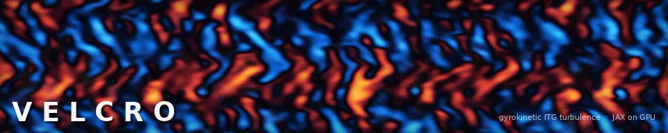

<p align="center"></p>

# Velcro

**A GPU-native, continuum gyrokinetic turbulence code in Python/JAX**, with a Laguerre–Hermite spectral velocity space
and a radially global (real-space-in-`x`) domain. The same source runs on CPU and on NVIDIA or AMD GPUs through XLA.

The banner is a Velcro run: saturated Cyclone-base-case ITG turbulence (R/L_T = 6.9, adiabatic electrons), the
electrostatic potential at the outboard midplane in a 128 × 641 ρ box, radial direction vertical.

## What it solves

The δf gyrokinetic Vlasov–Poisson system on field-aligned coordinates `(x, k_y, z)`:

- **Velocity space:** Laguerre–Hermite moments (Mandell, Dorland & Landreman 2018), exact recurrence matrices.
- **Space:** fourth-order finite differences in `x` and `z` (the parallel operator in an energy-conserving skew form), a
  de-aliased pseudo-spectral binormal direction, twist-and-shift parallel boundaries.
- **Field solve:** a real-space-in-`x` gyroaverage and polarisation operator, so temperature, density and `q` may vary
  across the box.
- **Time stepping:** explicit RK4 or an integrating-factor (Lawson) RK4, with CFL control.
- **Collisions:** exact Dougherty in moment space; the linearised Landau operator at k⊥ = 0; optional gyrokinetic
  finite-Larmor-radius collision terms.

Options, each off by default (with them off the code is bitwise identical to the adiabatic-electron solver):

- **Kinetic electrons** (`physics.electrons = "kinetic"`) at the real mass ratio, with A∥ when β > 0, optional δB∥
  (`physics.bpar`) and electron–ion collisions.
- **IMEX stepping for kinetic electrons** (`numerics.integrator = "imex"`): their parallel streaming is implicit.
- **Geometry:** s-α; native Miller (`geometry.kind = "miller"`); VMEC flux tubes in Boozer coordinates through
  `booz_xform` (`geometry.kind = "vmec"`); or GX's own geometry arrays (`geometry.kind = "gx_file"`).
- **Equilibrium E×B flow shear** (`physics.exb_shear`), with an optional parallel-velocity-gradient drive.
- **Generalised quasilinear** runs (`physics.gql_cutoff`).

Because the right-hand side is JAX, the exact linear operator and its eigenvalues come for free (`velcro/analysis.py`).

## Validation

Against analytic results and against GX (Mandell et al. 2024) on identical decks:

| Test | Reference | Velcro |
|---|---|---|
| Landau damping, slab | analytic root | < 1 % |
| GAM frequency, q = 1.4 | Sugama–Watanabe 1.936 v_t/R | 1.89–1.93 |
| Zonal-flow residual, ε = 0.18 | Xiao–Catto 0.103 | 0.103–0.108 |
| Linear ITG γ(k_y), Cyclone | GX | 1.02 at the peak (k_yρ_i = 0.28) |
| Linear ITG threshold | R/L_T ≈ 4.0 | ≈ 3.9 |
| Saturated χ_i, Cyclone, R/L_T = 6.9 | GX 2.24; Dimits 2.0 | 2.22–2.33 (three seeds) |
| fp32 vs fp64 | — | state agrees to 1.7 × 10⁻⁶ after 3 R/v_t; identical χ_i |
| Kinetic electrons, linear ITG and TEM | GX | γ within 5.1 %, ω within 2.7 % across the band |
| Rosenbluth–Hinton residual and GAM, kinetic electrons | GX | residual and frequency exact; damping within 1 % |
| β scan to the KBM onset, A∥ and δB∥ | GX | γ within 0.2 % at 32 of 44 points; transition β matches |
| Nonlinear TEM (R/L_n 5, R/L_Te 6) | GX | Q_e ratio 1.015, Q_i 1.007 |
| Native Miller and VMEC (W7-X, QA) tubes | GX's geometry modules | arrays within 10⁻⁴; linear kinetic-electron spectra within a few % |

Known gaps are listed under *Not in this release*.

## Install and run

```bash
uv venv && uv pip install -e ".[dev]"      # or: pip install -e ".[dev]"
python -m pytest tests -q
python -m velcro run examples/cyclone_nonlinear.toml
```

For GPUs, install the matching `jax[cuda12]` or `jax[rocm]` wheel. GKX's kinetic-electron example, with a fast fixed-step config,
is in [`examples/gkx_ke/`](examples/gkx_ke/); `python examples/race.py` races the two codes on it live. Practical settings:

- `run.precision = "fp32"` on consumer cards (fp64 runs at 1/64 rate there).
- `numerics.integrator = "lawson"` with `cfl 1.1` is 2–2.6× faster than RK4 and validated.
- `numerics.cfl_estimate = "spectral"` for L > 32 with RK4.
- Keep `M ≤ 24` (the unweighted Laguerre node transform overflows at M ≥ 32); `M = 8` is enough for fluxes.
- Do not set `numerics.hyper_z < 0.05` with `parallel_form = "advective"`.

## Layout

| Module | Contents |
|---|---|
| `velcro/basis.py` | Hermite–Laguerre basis, exact recurrence matrices, gyro-coefficients 𝒥_m(b), Γ₀ |
| `velcro/geometry.py` | Field-aligned metric: slab, global s-α tokamak, general 3D Fourier equilibrium |
| `velcro/operators.py` | 4th-order FD in x and z, twist-and-shift ghosts, 2/3-rule FFTs, skew-symmetric Poisson bracket |
| `velcro/fields.py` | Real-space gyroaverage operators and the quasi-neutrality solve |
| `velcro/vlasov.py` | Right-hand side: streaming, mirror, drifts, ∇F₀ drive, E×B nonlinearity, collisions, dissipation |
| `velcro/collisions.py`, `collisions_flr.py`, `landau.py` | Dougherty, FLR collision terms, linearised Landau |
| `velcro/kinetic.py` | Kinetic electrons: species right-hand sides, quasineutrality, Ampère and δB∥ |
| `velcro/miller.py`, `vmec_tube.py`, `gx_geometry.py` | Shaped and stellarator flux tubes |
| `velcro/simulation.py` | Profiles, RK4 / Lawson driver, CFL, diagnostics, output |
| `velcro/analysis.py` | Exact linear operator and eigenvalues, Prony fits, plasma dispersion function |
| `velcro/config.py` | pydantic input schema (TOML/JSON) |
| `tests/` | Every physics operator has one test against an independent answer (closed form or quadrature) and one property test (conservation, symmetry, convergence order) |

## Normalisation

Perpendicular lengths in ρ_ref = v_t/Ω (v_t = √(2T/m)), parallel lengths in L_ref, time in L_ref/v_t,
φ̂ = (eφ/T)(L_ref/ρ_ref), Ĝ = (δf/F₀)(L_ref/ρ_ref); ρ* = ρ_ref/L_ref is an explicit input. Gradients
ω_n = −L_ref ∂ ln n/∂x, ω_T = −L_ref ∂ ln T/∂x (Cyclone: 2.2 and 6.9 with L_ref = R₀). Against GX:
t[a/v_ti] = 1.964 t[R/v_t]; k_xρ_i = k_xρ_ref/√2; φ_GX = 0.509 φ.

## Not in this release

- multi-GPU;
- a validated global (profile + source) benchmark;
- a tested nonlinear stellarator run;
- nonlinear electromagnetic validation at β beyond 10⁻³;
- matrix-free gyroaverage operators (needed beyond N_x ≈ 200).

## Citing

If you use Velcro, please cite it with the metadata in [`CITATION.cff`](CITATION.cff).

## Licence

All rights reserved; see LICENSE.
